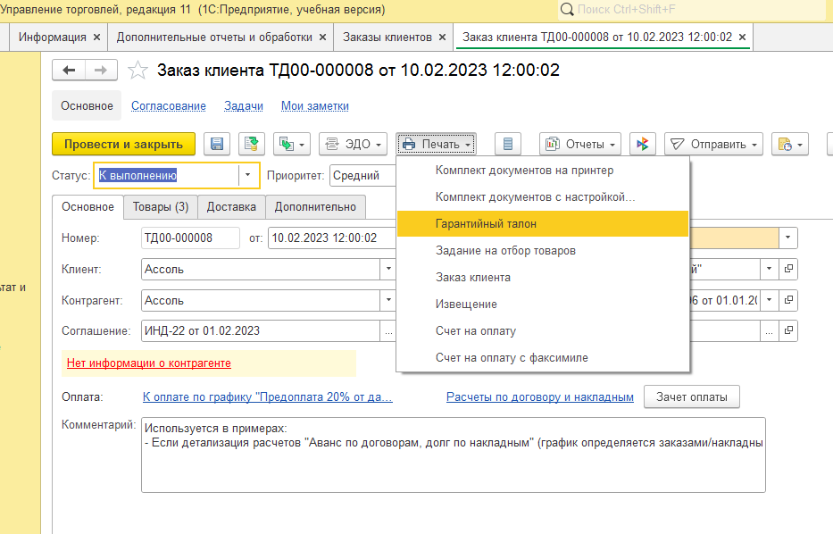
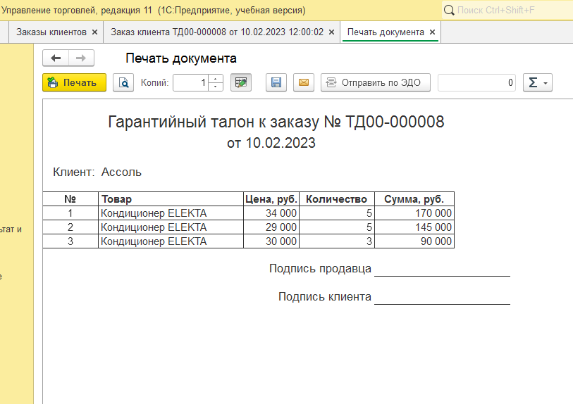

# Внешняя печатная форма "Гарантийный талон" для 1С:Управление Торговлей 11
Учебный проект: внешняя печатная форма для документа "Заказ клиента" в конфигурации 1С:Управление Торговлей. Демонстрирует навыки работы с механизмом БСП, запросами и макетами.

## Что реализовано 
- Регистрация через `СведенияОВнешнейОбработке` (БСП).
- Запрос к документу "Заказ клиента" (шапка и табличная часть "Товары").
- Вывод областей макета.
- Подключение через справочник "Дополнительные отчеты и обработки" без снятия конфигурации с поддержки.

## Фрагмент кода: регистрация обработки
Фрагмент демонстрирует регистрацию внешней печатной формы через механизм БСП.
```bsl
Функция СведенияОВнешнейОбработке() Экспорт
 
	//Получаем базовую структуру
	ПараметрыРегистрации = ДополнительныеОтчетыИОбработки.СведенияОВнешнейОбработке();	
	ПараметрыРегистрации.Вид = ДополнительныеОтчетыИОбработкиКлиентСервер.ВидОбработкиПечатнаяФорма();
	ПараметрыРегистрации.Наименование = "Гарантийный талон";
	ПараметрыРегистрации.Версия = "1.0";
	ПараметрыРегистрации.БезопасныйРежим = Ложь;

	//Привязка к документу УТ11
	ПараметрыРегистрации.Назначение.Добавить("Документ.ЗаказКлиента");
	
	//Добавляем команду в меню "Печать"
  	Команда = ПараметрыРегистрации.Команды.Добавить();
  	Команда.Представление = "Гарантийный талон";
  	Команда.Идентификатор = "ГарантийныйТалон";
  	Команда.Использование = ДополнительныеОтчетыИОбработкиКлиентСервер.ТипКомандыВызовСерверногоМетода();
  	Команда.Модификатор = "ПечатьMXL";

	Возврат ПараметрыРегистрации;
КонецФункции
```

## Как подключить
1. Скачайте файл `.epf` из этого репозитория.
2. В 1С:УТ 11 перейдите в **НСИ и администрирование - Печатные формы, отчеты и обработки**.
3. Включите флажок "Дополнительные отчеты и обработки" и перейдите по ссылке.
4. Нажмите **"Добавить из файла..."** и выберите скачанный `.epf`.
5. Откройте любой "Заказ клиента" и найдите команду в меню **"Печать"**.

## Скриншоты


